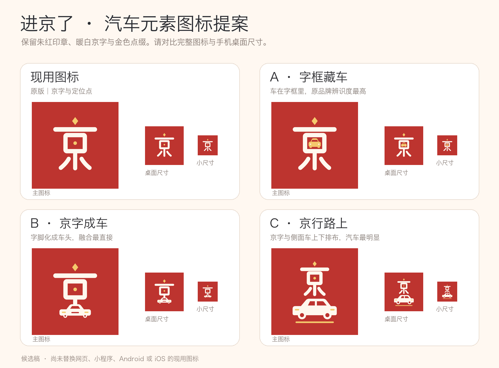

# 汽车元素图标候选

| 方案 | 设计思路 | 文件 |
| --- | --- | --- |
| A · 字框藏车 | 将金色汽车正面放进「京」字的中框，保留现有字形和识别度 | [SVG](A-字框藏车.svg) · [PNG](A-字框藏车.png) |
| B · 京字成车 | 把「京」字下部延展成汽车前脸，图形结合更紧密 | [SVG](B-京字成车.svg) · [PNG](B-京字成车.png) |
| C · 京行路上 | 「京」字与侧面汽车上下组合，小尺寸时汽车元素最明显 | [SVG](C-京行路上.svg) · [PNG](C-京行路上.png) |

三款方案均沿用朱红 `#BD342F`、暖白 `#FFF8EE`、金色 `#F4C96C`。**已选定 A 方案**，并将其用于 `品牌设计/logo-mark.svg`，同步导出网页、小程序、Android 和 iOS 图标。B、C 仅保留为设计备选。
