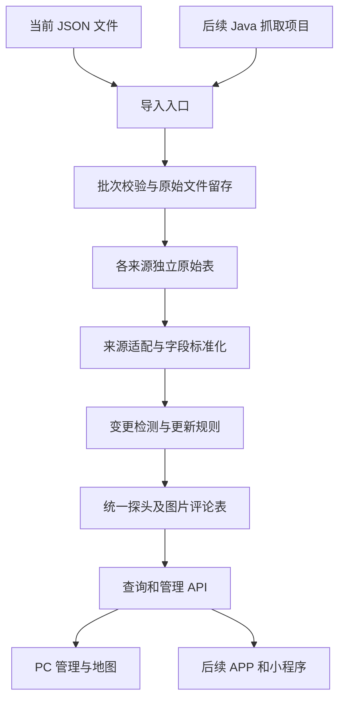

# 探头数据管理系统技术实现方案

版本：V1.3（设计与阶段一实现状态）<br>
日期：2026-10-29<br>
第一数据源：`duomaomao-cameras.json`，来源标识建议为 `duomaomao`。

## 1. 目标与已确认规则

先完成单来源 JSON 导入、统一存储、查询接口、PC 管理和地图展示。后续接入用户提供的 Java 抓取项目，再增加其他数据源、跨来源合并及冲突确认。

已确认：

- 每个来源独立保存原始数据，统一数据供多个客户端使用。
- 通过名称校准探头身份，空格、括号、附加标签的差异不必然代表不同探头；行驶方向等身份信息需要保留。
- 多来源阶段可指定基准来源，冲突默认采用基准值，同时保留差异供人工或 LLM 判断。
- 人工修改后的探头，每日同步只能更新类型、图片、评论。按整条记录受保护设计。
- 来源中消失的记录不处理，不自动删除或下架。
- `aa` 按输入的原始编码直接存储，现在不转换、不建立业务含义假设；后续提供映射逻辑后再更新。
- 数据库可以按维护需要拆表。
- 数据库已确定采用 PostgreSQL；Mac 开发与 VPS 生产使用同一主版本。
- 本机使用 macOS 开发，最终部署到 VPS 使用；生产方案按 Linux VPS 设计，具体发行版、CPU 架构和资源配置部署前核实。

本方案提出、尚非用户确认的默认实现：人工删除采用软删除，同步不自动恢复；第一版只标记疑似重复、不自动合并；LLM 第一版不接入。后续实施可据业务需要调整。

## 2. 当前文件检查结果

| 项目 | 结果 |
|---|---|
| 文件结构 | 顶层批次信息与 `cameras` 数组 |
| 探头数量 | 7,322 条，与顶层 `total` 一致 |
| 来源 ID | `id` 全部非空、无重复；跨批次稳定性尚待抓取项目验证 |
| 坐标 | 全部为合法范围的经纬度数值，坐标系未知 |
| 评论 | 77,353 条；按同一探头的昵称、时间、内容完全相同计算，有 28 条重复项 |
| 图片 | 全文件未提供图片字段，不能解释为来源确认没有图片 |
| 详情失败 | 1 条，`id=7417`，`detailError=upstream HTTP 400` |
| 完全同名 | 23 组，共 40 条额外记录，作为疑似重复候选 |
| 名称格式 | 1,562 条含不可见格式字符，匹配前需要清理 |
| 详情链接 | 存在重复，不能作为来源记录的唯一键 |
| 类型 | `w`、`6`、`2`、`1`、`a`、`4`、`5`，另有一条说明文字；全部原样保存 |

以上是当前文件的统计，不是后续数据量和编码范围的限制。

## 3. 技术选型与系统结构

建议采用模块化单体：一个后端进程、一套 PostgreSQL、一个 PC Web 前端。

| 部分 | 建议 | 目的 |
|---|---|---|
| 后端 | Java 17 + Spring Boot + Maven | 与后续 Java 抓取项目衔接，提供统一 REST API |
| 数据访问 | Spring JDBC，参数化 SQL | 导入、批量写入和字段保护逻辑清晰可控 |
| 数据库 | PostgreSQL 18，UTF8 编码 | 保存统一数据、来源 JSONB、评论与操作记录；具体补丁版本实施时锁定 |
| 数据库迁移 | Flyway + PostgreSQL 支持模块 | 记录表结构版本，部署时按版本升级 |
| PC 前端 | Vue 3 + TypeScript + Vite | 管理列表、导入报告、详情和地图交互 |
| 地图 | 独立地图适配模块，供应商待坐标系及账号确认后确定 | 隔离地图 SDK 和坐标转换 |
| 部署 | Docker Compose，后端、数据库、静态页面服务 | 便于本地启动和单机部署 |
| 文件留存 | 持久化目录保存原始导入文件 | 出错后可重放、核查原始输入 |

实施时锁定相互兼容且受支持的稳定依赖版本。第一版无需引入 Redis、消息队列、搜索集群或微服务。



抓取项目负责获取数据；导入服务负责校验、入库、合并与人工保护。抓取项目不直接修改统一表。

## 4. 数据模型

### 4.1 第一阶段表结构

| 表 | 职责及关键字段 |
|---|---|
| `data_source` | 来源配置：`id`、`code`、名称、坐标系、是否启用；预留来源优先级 |
| `import_batch` | 导入批次：来源、文件哈希、文件路径、采集时间、状态、规则版本、统计、开始结束时间、错误摘要 |
| `import_record` | 每条导入结果：批次、文件行序号、来源记录 ID、处理状态、错误码、错误说明；便于部分失败重试 |
| `raw_duomaomao_camera` | 当前来源独立原始表：来源记录 ID、最新原始 JSON、内容哈希、最近观察批次、最后成功应用哈希、详情状态、最后见到时间 |
| `camera` | 统一探头：内部 ID、显示名称、匹配名称、原始经纬度、坐标系、当前类型原文、人工保护标志、软删除时间、版本号、创建更新时间 |
| `camera_source_link` | 来源关联：探头 ID、来源 ID、来源记录 ID、首次与最近关联时间 |
| `camera_comment` | 展示评论：探头 ID、昵称、内容、原始时间、解析时间、去重指纹 |
| `comment_source_link` | 评论来源关联：评论 ID、来源 ID、来源探头 ID、来源评论键；后续多个来源的相同评论仍可追溯 |
| `camera_image` | 图片：探头 ID、URL、URL 指纹、排序；当前文件不产生图片记录 |
| `image_source_link` | 图片来源关联：图片 ID、来源 ID、来源探头 ID |
| `camera_audit_log` | 人工和同步操作记录：探头 ID、操作者、动作、变更前后值、来源批次、时间 |

管理认证优先使用框架的成熟会话认证能力；第一版管理员账户配置化，密码只保存安全哈希。需要多用户管理时再增加用户与角色表。

原始表保存最新观察值，原始文件按批次留存历史。即使某条统一数据更新失败，也能通过导入结果和原始文件重试；不能仅以原始表已更新就认为统一数据已应用。

### 4.2 字段约定与约束

- 所有统一主键由系统生成，来源 ID 当字符串保存；不能把来源 `id` 直接当统一 ID。
- `raw_duomaomao_camera.source_record_id` 唯一；`camera_source_link` 的 `(source_id, source_record_id)` 唯一。
- `camera.name_match` 建普通索引，不设唯一约束：实际同名记录不一定是同一个探头。
- 名称匹配使用固定规范化规则和精确比较，不依赖数据库默认排序规则去模糊合并。
- 经度、纬度使用 `NUMERIC(10,7)`；原始 JSON 保留源精度。坐标系使用显式字段，初始值为 `UNKNOWN`。
- 类型字段 `type_code_raw` 使用 `TEXT`，原样保存 `aa`，不转整数、不设枚举、不裁剪说明文字。当前唯一来源下直接展示该字段。
- 后续新增可空的 `standard_type_id`，建立 `(source_id, raw_code, mapping_version)` 映射。映射更新标准类型，不覆盖原始编码；界面需对原始类型文本做长度收纳和输出转义。
- 评论去重指纹由原始昵称、时间、内容组成的确定性 JSON 计算 SHA-256；以探头 ID 加指纹唯一。指纹命中时核对原字段，避免误合并。
- 评论保存原始时间；没有时区的时间先按来源配置解析。当前建议 `Asia/Shanghai`，需要从抓取项目验证；解析失败保留原文并标记，不使整个批次失败。
- 图片按 URL 精确去重，不主动删除查询参数，避免破坏签名或不同图片身份。
- 来源关联和评论列表分别对来源键、`(camera_id, parsed_time, id)` 建索引；软删除字段、人工保护字段按查询需要建索引。

PostgreSQL 实现约定：

- 原始记录结构存为 `JSONB`，可用于字段查询；完整原始文件仍按字节留存，因为 JSONB 不保留键顺序、空白及重复键，不能代替原文件归档。预检拒绝重复对象键，避免转换时悄悄丢失字段。
- 时间点使用 `TIMESTAMPTZ`，Java 使用 `Instant` 或 `OffsetDateTime`；原始无时区时间文本单独保留。开关使用 `BOOLEAN`，主键采用 `BIGINT GENERATED BY DEFAULT AS IDENTITY`，API 中 ID 以字符串传输，避免前端整数精度问题。
- 普通查询使用 B-tree；针对未删除探头的高频查询按需使用 `WHERE deleted_at IS NULL` 的部分索引。JSONB 只有出现实际检索需求时再添加 GIN 或表达式索引，避免无用索引增加导入成本。
- 使用 PostgreSQL JDBC 驱动及兼容版本的 Flyway PostgreSQL 支持模块，SQL 统一采用 PostgreSQL 方言。来源幂等写入可使用 `INSERT ... ON CONFLICT`，仍需配合事务、字段保护和版本检查，不能无条件覆盖统一表。
- 应用角色不使用数据库超级用户；表结构迁移使用独立迁移角色。数据库主版本升级作为独立维护任务，使用经过验证的 `pg_upgrade` 或逻辑导出恢复流程，不能直接换镜像主版本复用旧数据目录。

### 4.3 当前来源的字段映射

| 输入字段 | 统一字段或用途 |
|---|---|
| `id` | `sourceRecordId`，转字符串 |
| `name` | `name`；`cameraName` 保留在原始 JSON 用于核查 |
| `position[0]`、`position[1]` | `longitude`、`latitude` |
| `aa` | `typeCodeRaw`，完全原样 |
| `time`、`creatTime`、`edittime` | 来源日期信息，不能当作系统创建更新时间，也不能仅凭这些字段判断有无更新 |
| `href` | 来源相对详情链接，保留原文；来源域名确认后才能拼接 |
| `comments[].nickname/content/time` | 评论昵称、内容、原始时间 |
| `commentCount` | 来源声明数量，用于校验；页面数量按实际去重后的评论计算 |
| `detailError` | 详情获取状态，控制本次允许更新的内容 |
| 顶层 `generatedAt` | 批次采集时间，与系统导入时间分开 |
| 未提供图片字段 | 图片状态为 `NOT_PROVIDED`，不清空已有图片 |

来源适配层输出统一对象及字段完整性状态，至少区分 `PROVIDED`、`NOT_PROVIDED`、`FAILED`。不能用一个空数组同时表达“没有数据”和“没有抓到”。

## 5. 单来源导入流程

### 5.1 导入入口与批次校验

1. 管理端上传 JSON，创建批次并保存到服务端受控持久化目录，使用系统生成的文件名。
2. 限制文件大小、JSON 深度和记录数量；校验顶层结构、`total` 与数组长度。结构损坏或重复来源 ID 使批次校验失败，保留报告。
3. 计算文件哈希。完全相同且已成功应用、规则版本未变的文件可直接返回上次结果；规则升级允许显式重放，失败批次允许重试。
4. 提供预检模式：生成新增、变更、异常和疑似重复统计，不修改原始当前表或统一业务表。正式执行时重新检查当前版本，预检不是锁定快照。
5. 正式执行使用数据库中的来源级租约锁，同一来源串行导入；崩溃可超时恢复，通过持有者令牌防止旧任务继续写入。

### 5.2 逐条处理

1. 按来源 ID 定位原始记录，保存原始 JSON 和本次观察状态。
2. 做基础校验及标准化；当前文件的所有 `aa` 值都可接受，不因说明文字拒绝入库。
3. 用业务内容计算语义哈希：包含名称、坐标、类型以及有效图片评论，字段键顺序和评论排列顺序不影响结果；不包含批次时间、耗时、错误文本等抓取元数据。
4. 对比最后成功应用的哈希和规则版本，识别新增、变更与未变。缺失/失败字段不生成清空动作；详情恢复成功后重新处理。
5. 优先通过来源关联定位统一探头；已有来源记录改名时仍更新同一探头，不能因改名生成新探头。
6. 新来源记录第一版创建独立探头，同时计算名称匹配键，记录疑似重复候选；不把现有 23 组同名记录直接全部合并。
7. 按人工保护、软删除等规则决定可写字段，更新图片评论及其来源关联。
8. 在同一条记录的事务内提交统一数据、关联、最后成功应用标记和结果；单条失败回滚其业务变更，记录错误后继续其他记录。
9. 批次结束汇总 `新增 + 更新 + 未变 + 失败 + 跳过 = 输入记录数`。详情不完整、疑似重复等作为额外警告维度，不能重复计入主结果数量。

批次状态建议：`UPLOADED → VALIDATING → RUNNING → SUCCEEDED / PARTIAL_SUCCESS / FAILED`；预检使用独立状态。当前详情失败的记录仍可导入基础信息，但报告必须显示 1 条详情警告。

第一版不要求全文件原子替换：页面可能在导入过程中看到部分已更新内容，批次页面明确显示进度。每个探头自身的更新保持事务一致。

### 5.3 人工维护与来源缺失规则

| 情况 | 同步行为 |
|---|---|
| 未人工修改 | 更新来源提供的有效字段；来源没有提供的字段保持原值 |
| 已人工修改 | 只允许更新 `type_code_raw`、图片、评论；名称、坐标和其他字段保持原值 |
| 人工修改类型 | 仍可能被下一次有效同步覆盖，因为类型在允许同步范围内；编辑页明确提示 |
| 来源记录消失 | 不改业务记录，不删除，不下架 |
| 详情失败 | 基础字段按正常规则处理；评论、图片不做清空或删除 |
| 图片/评论列表变少或为空 | 第一版采用追加、精确去重，不据此删除历史内容 |
| 人工删除 | 建议软删除并保留来源关联；继续保存原始数据，统一记录不自动恢复 |

同步和人工编辑必须在同一事务中重新检查保护标志与版本号，避免先读取“未保护”、随后覆盖刚发生的人工编辑。人工更新接口携带版本号，过期返回 409。

## 6. 名称校准和多来源扩展

### 6.1 名称规范化

同时保存展示名称、原始来源名称和匹配名称。匹配规则版本化，便于将来重算。

- 统一全半角、空白、已知不可见格式字符和括号形式。
- 将已确认的附加标签（例如“六环外”）提取到标签，不参与身份匹配。
- 括号内的方向信息仍参与匹配，不能直接删除所有括号内容。
- 保留“南向北/北向南”“主路/辅路”“交口东/交口西”等区别位置和方向的信息。
- 道路简称、区域别名、语义相近名称先列为候选，不采用任意字符串相似度直接合并。

例如以下名称生成相同匹配键：

```text
顺义区 香堤北街香堤中路交口 南向北【六环外】
顺义区香堤北街香堤中路交口 【南向北】
→ 顺义区香堤北街香堤中路交口南向北
```

名称是身份校准主依据；坐标和方向用于识别可疑冲突。坐标系未知时，不自动转换、不用距离阈值强行判定。

### 6.2 接入第二个来源时

- 新增对应原始表和一个来源适配器，复用批次、校验、统一写入服务。
- 新记录先查已有来源关联，再做名称候选匹配；明确的唯一匹配是否自动合并，在评估首批候选后确定。
- 相同名称但方向冲突、多候选或坐标明显矛盾的记录进入人工确认。
- 新增 `camera_conflict` 表，记录字段名、各来源候选值及版本、当前采用值、处理状态、确认人和依据。
- 基准来源存在有效值时优先采用；基准没有提供字段时可由其他来源补充；只有其他来源包含的探头也正常收录。
- 人工保护优先于基准来源。图片和评论按集合合并；不同来源的类型编码不能直接当作相同业务类型比较，需等待来源各自的映射。
- 人工处理冲突时区分“本次接受”与“持续人工保护”。本次接受记录对应的候选值版本，候选再次变化才重开冲突。
- 合并操作迁移来源关联、图片评论及其溯源，保留旧探头 ID 到新 ID 的重定向和审计记录。原始数据不删除。

LLM 可在后续生成匹配或冲突建议；输入名称、评论等仅作为外部数据，不作为指令。默认不自动修改正式数据，保留模型建议、依据和人工结论。

## 7. 接口与前端

### 7.1 API 草案

| 接口 | 用途 |
|---|---|
| `POST /api/v1/admin/imports/preview` | 上传文件并预检 |
| `POST /api/v1/admin/imports/{id}/execute` | 执行已上传文件，返回异步批次 ID |
| `GET /api/v1/admin/imports/{id}` | 查询进度、统计、警告 |
| `GET /api/v1/admin/imports/{id}/records` | 分页查看逐条结果，支持筛选失败项 |
| `POST /api/v1/admin/imports/{id}/retry` | 重试失败记录，按当前状态重新校验 |
| `GET /api/v1/cameras` | 分页查询，支持名称、来源、原始类型过滤 |
| `GET /api/v1/cameras/map` | 按视口及缩放级别返回点位或聚合点 |
| `GET /api/v1/cameras/{id}` | 探头基础信息、图片、来源和状态 |
| `GET /api/v1/cameras/{id}/comments` | 评论独立游标分页 |
| `POST /api/v1/admin/cameras` | 手动创建探头，默认人工保护 |
| `PATCH /api/v1/admin/cameras/{id}` | 人工修改并启用保护，要求版本号 |
| `DELETE /api/v1/admin/cameras/{id}` | 软删除 |
| `POST /api/v1/admin/cameras/{id}/restore` | 显式恢复软删除记录 |
| `GET /api/v1/admin/cameras/{id}/audit-logs` | 查看操作历史 |

后续抓取项目通过受认证的导入入口提交相同文件协议，获取批次结果；不暴露可指定任意服务器文件路径的导入接口。读取接口不返回原始抓取错误、管理身份等内部字段。

### 7.2 PC 页面

1. **导入管理**：上传、预检、执行、进度、统计与失败详情。
2. **探头列表**：名称搜索、来源和原始类型筛选、人工保护标记、疑似重复标记。
3. **探头详情与编辑**：位置、类型原文、图片、分页评论、来源记录、操作历史。
4. **地图**：视口查询、缩放聚合、点击查看详情；未知类型采用通用标记，不推测含义或颜色。

地图接口只返回必要字段，不能一次携带 77,353 条评论。小范围返回探头点，大范围采用网格聚合，聚合坐标必须处于统一已知坐标系；设置明确返回上限与聚合标志，避免静默截断点位。

初期约 7 千点可先用经纬度范围查询并实测，再根据执行计划增加空间索引；不预先引入 GIS 服务。源坐标与地图坐标分开，确认来源坐标系后才做展示转换，禁止把转换后坐标反写到来源原值。

空间扩展采用 PostGIS，第一阶段无需安装。需要附近距离或区域相交查询时，在确认坐标系及转换方案后新增空间列，并建立 GiST 索引；例如经过确认和转换的 WGS84 坐标可派生为 `geography(Point,4326)` 用于米制距离查询。不能直接把坐标系未知或 GCJ-02 的原始坐标标成 EPSG:4326；PostGIS 也不会自动识别这些来源坐标。启用时同步核实 PostgreSQL、PostGIS 和目标 CPU 架构的镜像兼容性。

坐标系和地图账号未确认时，导入、列表、详情仍可完成；地图准确展示的验收需等待这两项落实。通过已知路口位置进行人工抽检。

## 8. 部署、可靠性与基本安全

- 数据库、原始文件目录使用持久卷；定期备份数据库和原始文件，并验证能恢复。
- 业务日志记录批次 ID、来源记录 ID 和错误码，避免把整份评论内容写入普通日志。
- 导入任务状态存数据库，重启后可标记中断并恢复；同源串行、不同源写同一探头时使用事务锁和版本检查。
- 防止旧采集批次覆盖新数据：比较采集时间；时间不可信或缺失时串行接收并标记，历史重放需要显式模式。旧文件可核查，不能默认回滚现有值。
- 管理写接口要求认证；同源部署使用安全 Cookie 会话与 CSRF 防护。后续抓取项目使用独立服务凭据。
- 来源名称、评论、类型以纯文本显示，防止外部字符串成为页面 HTML；图片链接仅允许合适的 HTTP(S) 协议，第一版不由服务端抓取任意外部 URL。
- 原始 JSON 历史留存和备份保留周期部署时配置，避免无限增长。

### 8.1 Mac 开发与 Linux VPS 环境划分

采用同一份业务代码和数据库迁移，环境差异通过配置管理。

| 项目 | Mac 开发环境 | VPS 生产环境 |
|---|---|---|
| Java 后端 | IDE 或 Maven 启动，方便调试 | 运行已构建的 Linux 容器镜像 |
| Vue 前端 | Vite 开发服务器，代理 `/api` 到本机后端 | 构建为静态文件，由 Nginx 提供 |
| PostgreSQL | 本机 Docker 中独立开发数据库 | VPS Docker 中独立生产数据库 |
| 完整联调 | 发布前运行完整 Compose 环境 | 按生产 Compose 配置运行 |
| 数据路径 | 配置化本机目录或命名卷 | 固定持久化目录或命名卷 |
| 网络入口 | 本机回环地址端口 | 域名、HTTPS 与反向代理 |
| 定时抓取 | 默认关闭，需要时手动运行 | 后续启用唯一生产调度入口 |

日常开发不必每改一行代码就重建镜像；发布前必须验证完整容器环境。生产运行不依赖 Mac 开机，也不依赖 Mac 上的文件路径、数据库或服务。

### 8.2 CPU 架构及文件兼容性

- 如果 Mac 是 Apple Silicon，本机容器通常为 `linux/arm64`；VPS 可能为 `linux/amd64` 或 `linux/arm64`。构建前核实目标架构，使用 Docker Buildx 构建目标平台镜像，需要兼容两类服务器时发布多平台镜像。
- Java 字节码通常可跨平台，但运行镜像、JRE 和任何原生依赖必须支持目标平台。前端依赖也在构建环境安装，不复制 Mac 的 `node_modules` 到 Linux。
- 固定 JDK、数据库主版本和依赖锁文件；镜像使用明确版本，正式发布记录镜像摘要，不使用浮动 `latest` 作为回滚依据。
- 代码及 Compose 不写死 `/Users/qiuyanfeng/...`。容器内统一使用如 `/app/data/imports` 的路径，宿主机通过挂载配置。
- SQL 表名、文件名统一小写，代码导入路径严格匹配大小写；避免 macOS 与 Linux 文件系统行为不同造成部署故障。
- 系统时间保存为统一 UTC 时间，来源无时区文本按来源配置解析；页面和每日调度明确使用 `Asia/Shanghai`，不依赖宿主机默认时区。

多平台构建方式参考 [Docker 官方文档](https://docs.docker.com/build/building/multi-platform/)。

### 8.3 配置和网络

- 提供 `application-local.yml`、`application-prod.yml` 和 `.env.example`；数据库密码、管理员密码哈希、抓取凭据、服务端地图密钥通过环境变量或挂载的密钥文件注入，不提交到仓库、不打进镜像。生产缺少必要密钥时启动失败，不能回退到开发默认值。
- 所有浏览器请求使用相对地址 `/api`，生产由 Nginx 转发到后端，避免把 `localhost` 或容器服务名打包进前端代码。
- VPS 上 Nginx、后端、数据库通过 Compose 内部网络连接；后端使用数据库服务名（例如 `db:5432`），不用 `localhost`。本机 IDE 启动的后端才连接开发数据库映射的回环端口。参考 [Compose 网络说明](https://docs.docker.com/compose/how-tos/networking/)。
- 生产只发布 Web 入口的 80/443 端口，数据库及后端不向公网发布端口；SSH 作为服务器维护入口单独限制访问。远程数据库排查通过 SSH 隧道进行。
- HTTPS 证书由服务器自动续期；前端静态资源与 API 使用同一站点。反向代理配置上传大小及超时，导入请求只排队返回批次 ID，不长期占用 HTTP 连接。
- 浏览器地图 Key 按供应商规则设置生产域名限制；服务端密钥不使用 `VITE_*` 等会进入前端构建结果的变量。
- Compose 基础文件不发布数据库端口；只有开发覆盖文件添加 `127.0.0.1` 端口映射，避免生产继承开发端口。

### 8.4 持久化、首发和升级

建议 VPS 应用配置放在 `/opt/jinjing2`，数据库和导入文件使用命名卷或独立数据目录，备份放到另外的存储位置。具体路径可配置。

首次上线：

1. 核实 VPS 系统、架构、内存、磁盘、已有服务及域名；安装受支持的 Docker Engine 与 Compose。
2. 在 Mac 或 CI 构建目标平台镜像，通过受控镜像仓库传输；没有镜像仓库时可传输镜像归档，不要求 VPS 编译源码。
3. 配置生产密钥、持久卷、HTTPS 和网络入口，启动数据库并等待健康检查通过，再执行数据库迁移和启动应用。
4. 将原始 JSON 通过管理导入入口导入生产环境，检查探头数量、评论数量、原始类型和警告。默认不复制开发数据库，避免把测试编辑带到正式环境。
5. 验证外部 HTTPS 查询、登录与编辑、容器重启数据保留、批次报告和备份恢复。已产生人工维护成果的开发数据如需迁移，应另做一次完整逻辑迁移及核对，不仅重导原始 JSON。

后续升级：

1. 发布前备份生产数据库和必要文件，记录当前镜像版本、迁移版本与备份位置。
2. 暂停新的导入任务，等待运行中的任务结束；拉取新版本镜像，执行受控数据库迁移并更新应用。配置健康检查、重启策略和数据库连接重试。
3. 验证登录、探头查询、人工保护、导入状态后恢复任务；单机 Compose 更新可能短暂中断服务，第一版不承诺零停机。
4. 保留上一版镜像。仅在新表结构向后兼容时直接回退应用；涉及不兼容结构或数据变更时，按恢复方案处理，不能认为换回旧镜像就能回退数据库。

生产数据库以正式环境为准，后续发布不能用 Mac 开发数据覆盖。部署脚本不执行 `docker compose down -v`，升级不能删除持久卷。Compose 的生产覆盖配置方式参考 [Docker 生产部署指南](https://docs.docker.com/compose/how-tos/production/)。

### 8.5 VPS 运行与验收

- Java 堆、容器内存、PostgreSQL 的 `shared_buffers`、`work_mem`和数据库连接池按 VPS 实际资源设置，为操作系统及数据库预留内存；不假设小内存 VPS 可以套用开发机默认值。
- 关闭生产调试模式和 Vite 开发服务；设置日志轮转，观察磁盘剩余、内存、服务健康及导入失败状态。
- 使用 `pg_dump -Fc` 做数据库一致性逻辑备份，以 `pg_restore` 在隔离环境恢复验证；角色及权限需单独管理或备份，原始文件与备份清单一起留存。备份工具使用与服务端匹配的版本，不直接复制运行中的 PostgreSQL 数据目录充当有效备份。备份加密并复制到 VPS 之外。
- 部署验收覆盖目标 Linux 架构实际启动、迁移成功、重启后数据仍在、HTTPS/API 正常、数据库无公网端口、时区正确、上传文件可读取和上一版本恢复演练。
- 后续定时抓取在 VPS 或独立受控执行环境运行，由一个调度入口负责；不得同时启用 Mac 和 VPS 的生产任务。当前 JSON 导入阶段不创建任何定时任务。

## 9. 分阶段交付与验收

### 阶段一：单来源导入与统一数据

交付后端基础项目、数据库迁移、JSON 预检与导入、数据查询及导入报告，同时提供 Mac 本地配置、Dockerfile 和基础 Compose 配置，为 Linux VPS 发布做准备。

关键验收：

- 当前文件产生 7,322 条原始记录。按本方案第一版不自动合并的默认策略，首次空库导入产生 7,322 条统一记录。
- 当前文件在每个来源探头内精确去重后为 77,325 条评论；如果后续确认合并探头，该数量可能继续变化。
- 所有 `aa` 值逐项一致，包括那条说明文字；无擅自映射或丢弃。
- 同文件重复执行不增加探头、评论或图片；新增、内容更新和恢复失败记录可正确处理。
- `id=7417` 基础信息可用，详情不完整可见；模拟已有评论后再次遇到详情失败，不会清空评论。
- 人工保护记录只有类型、图片、评论可被有效同步更新；缺失记录保持不变。
- 验证一条记录中途失败、进程中断后重试、同来源并发提交和人工编辑与同步交错时的一致性。

### 阶段二：PC 管理与地图

交付导入页面、探头列表、详情编辑、软删除恢复、地图聚合和评论分页。落实地图 SDK 账号、来源坐标系，抽查已知路口；验证地图视口变化不会漏点或重复展示，原始内容安全显示。同时完成 VPS 生产配置、反向代理、HTTPS、部署说明与备份恢复说明，并在实际目标环境验收。

### 阶段三：定时抓取

用户提供 Java 项目后确认来源 ID 稳定性、类型字段输出、坐标系、时间语义、详情及评论是否分页抓全。先以独立抓取任务每天执行，通过导入接口提交结果；抓取失败不触发空数据覆盖。调度时区和具体执行时间可配置。

若 `id` 只是抓取过程的顺序号，必须先修正稳定来源键，再启用自动同步，不能依赖当前一份文件中的唯一性认定跨批次稳定。

### 阶段四：多来源和类型映射

增加来源适配器、名称候选确认、合并记录、基准来源与冲突页面。收到类型映射后增加标准类型并执行可重跑回填，同时保留原始类型原文。按实际需要再增加 LLM 建议能力。

## 10. 建议目录

```text
jinjing2/
├── 需求文档.md
├── 技术实现方案.md
├── duomaomao-cameras.json
├── backend/                 # 后续创建
│   └── src/main/
│       ├── java/.../
│       │   ├── ingestion/   # 批次、任务、预检、重试
│       │   ├── source/      # DuomaomaoAdapter 等来源适配
│       │   ├── camera/      # 统一数据、同步保护、人工维护
│       │   ├── matching/    # 名称规范化、重复候选
│       │   └── security/    # 管理认证与服务凭据
│       └── resources/db/migration/
├── frontend/                # 后续创建，PC 管理与地图
└── deploy/                  # 后续创建
    ├── compose.yaml         # 基础服务，不发布数据库端口
    ├── compose.dev.yaml     # 本机端口及开发挂载
    ├── compose.prod.yaml    # VPS 镜像版本、重启及资源配置
    ├── .env.example         # 配置模板，不含真实密钥
    ├── nginx/               # 静态页面、API 反向代理与 HTTPS
    └── README.md            # 首发、升级、备份恢复操作说明
```

## 11. 技术资料

以下官方资料用于核对技术可用性，业务流程和表结构为本项目的设计建议：

- [Spring Boot 系统要求](https://docs.spring.io/spring-boot/system-requirements.html)：Java 17 处于当前文档声明的支持范围，具体版本组合在建项时锁定。
- [PostgreSQL 版本支持政策](https://www.postgresql.org/support/versioning/)：选择受支持的 PostgreSQL 18，实施时锁定补丁版本。
- [PostgreSQL JSON 类型](https://www.postgresql.org/docs/18/datatype-json.html)：JSONB 存储、索引及其与原始 JSON 文本的差异。
- [PostgreSQL 备份工具](https://www.postgresql.org/docs/18/app-pgdump.html)：逻辑备份及恢复流程。
- [PostGIS 空间索引](https://postgis.net/documentation/faq/spatial-indexes/)：后续空间查询使用 GiST 索引和可利用索引的空间函数。
- [Vue 3 官方入门](https://vuejs.org/guide/quick-start.html)：前端工程基础。

## 12. 当前实现状态

已创建 `backend/` Java 17 + Spring Boot 项目、PostgreSQL 18 的 Flyway V1 建表迁移、躲猫猫 JSON 异步导入、批次结果查询、探头分页查询与基础管理接口，以及本机 Compose 配置。导入逻辑原样保存 `aa`，来源内 `id` 与统一探头 ID 分开管理。

在隔离的本机 PostgreSQL 18 测试库中，以当前 JSON 验证首次导入：7,322 条探头、77,325 条去重后评论、0 条失败、1 条详情警告。第二次同文件导入：7,322 条未变化。人工修改后再导入变更样本：名称和坐标保留人工值，类型更新为来源值。测试库不属于正式环境。

尚未实现的设计项包括：导入预检、失败记录单独重试、图片导入与编辑、地图聚合、多来源匹配与冲突处理、PC 页面、生产 Nginx/HTTPS 以及定时抓取。当前地图接口仅按视口返回点，并标明是否截断；导入任务按单实例串行运行。现有 `deploy/compose.yaml` 用于本机开发与服务器内部试运行，公网发布仍需补齐生产配置。
